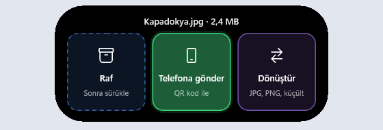
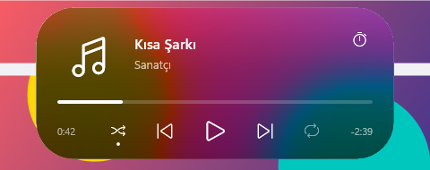
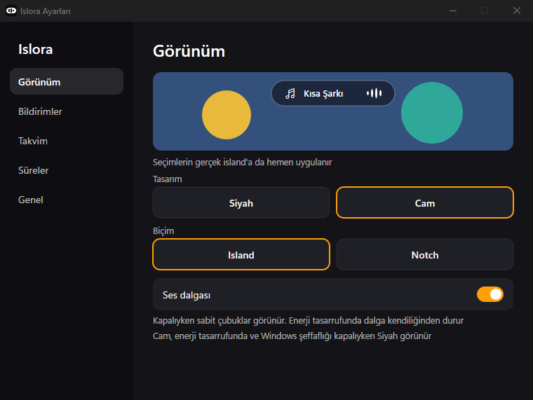

# Islora

A live island for Windows 11. Islora shows what your PC is doing in a small black or glass pill at the top of the screen, and hides when there is nothing to show.

<table>
  <tr>
    <td></td>
    <td></td>
  </tr>
  <tr>
    <td></td>
    <td></td>
  </tr>
  <tr>
    <td></td>
    <td></td>
  </tr>
  <tr>
    <td></td>
    <td></td>
  </tr>
</table>

> [!NOTE]
> Islora is at an early stage. The interface is in Turkish only, and Islora has only been run on a Windows 11 Insider build so far. The timer and calendar screens will change.

## Download

Get `islora.exe` from the [latest release](https://github.com/ucanalgan/islora/releases/latest), put it in any folder and run it. There is no installer. It needs 64-bit Windows 11.

The file is not signed, so SmartScreen may warn you the first time. Choose **More info**, then **Run anyway**.

## What it shows

- **Music and video:** cover, title, artist, progress and playback buttons for any player that reports to Windows, such as Spotify, or YouTube and YouTube Music in a browser. You can seek, shuffle and repeat when the player allows it. Where a player has no previous or next, as for a single video, the buttons beside play jump 10 seconds back and 30 forward. Songs are told from videos by what comes with them, such as an album, a square cover, the controls on offer and the title, not by which app or site plays them, so a new song is announced and the next video is not.
- **Timers:** Islora's own countdown, Windows Focus sessions in both directions, and running timers from the Clock app. Clock timers are read-only, as Windows offers no public way to create them.
- **Calendar:** events from a private iCal address, as a bubble 30 minutes before they start, in the pill 5 minutes before, and as an alert when they begin.
- **Files:** drag files to the top of the screen and three places open. **Raf** keeps them at hand to drag somewhere else later. **Telefona gönder** shows a code that a phone camera scans to download them over your network, with no app or account on the phone. When the phone is on another network, **Doğrudan bağlan** has the computer open a small Wi-Fi network of its own: the phone joins it with one code and downloads with a second, or, with Windows' Mobile Hotspot on, serves the files there. If no phone has opened the page after 45 seconds, the code suggests it, as some networks keep their devices apart. With Wi-Fi off and nothing else connected, the send waits and makes its code once Wi-Fi is back. **Dönüştür** saves pictures as JPG or PNG, or makes them smaller, next to the original.
- **System changes:** volume, brightness, Caps Lock, Num Lock, charger, low battery, Energy Saver, Bluetooth, sound output, microphone, camera, internet, Wi-Fi, VPN, airplane mode, USB drives, displays, screenshots and screen clips, copied items, new songs and keyboard language.
- **Windows notifications:** opt in under **Ayarlar > Bildirimler** and allow Windows access. Islora follows notifications from any app that posts them to Windows Notification Center, without an app list. It shows the sender's app icon and available message text; notifications without readable text still show their app name. Click to open the source app, or right click to mute that app in Islora. For WhatsApp Web in Chrome, a click selects an existing WhatsApp tab when available. The same page can clear muted apps. Focus sessions can hide these previews. With the standalone exe, Islora checks for new notifications about every five seconds; it does not save their text to disk. Windows' own notification remains in Notification Center. Clicking Islora's preview opens the app, not the exact message.

Two things can run at once: the main one sits in the pill and the second in a bubble beside it. A focus session, timer or file send keeps to the bubble by default while music plays, so the music stays where it was, and volume or brightness never covers an open code or panel.

The island hides during fullscreen apps and leaves itself out of screenshots, screen recordings and screen sharing.

Under **Ayarlar > Düzen**, choose which connected display shows the island. If that display is disconnected, Islora uses the primary display until it returns.

## Using it

| To | Do this |
|---|---|
| Open the island | Press `Win+Alt+Space`, or move the pointer to the middle of the top screen edge. If that shortcut is taken, `Ctrl+Shift+Alt+Space` is used instead. |
| Expand or collapse it | Click the pill. Moving the pointer away also collapses it. |
| Switch to the second thing | Click the bubble. |
| Keep, send or convert files | Drag them to the middle of the top screen edge, or onto the island, and drop them on one of the three places. Files on the shelf wait in a bubble beside the island: click it to drag them out again. |
| Start a timer or see your next events | Open the home view with the timer icon or by pressing the shortcut twice. |
| Choose how focus, timers or a send share the island with music | On the settings window's Düzen page: **Baloncukta**, **Yan yana** or **Öne çıkar**. The picture shows a send as an example and changes with each choice. |
| Change settings | Open Islora again from the Start menu or its exe, or use the gear in the home view or the tray menu. The window works with the keyboard too: Tab and the arrows move, Enter or Space press, Esc closes. |

## Settings

The settings window opens by itself on first run, and changes apply at once. Everything in it is stored in `%APPDATA%\Islora\config.toml`, which you can also edit by hand. After editing the file, choose **Takvimi ve ayarları yenile** on the window's Genel page.

| Setting | Meaning | Default |
|---|---|---|
| `calendar_ics_url` | Private iCal address of your calendar. Treat it like a password. | empty |
| `timer_presets` | The four durations in the home view, in minutes. | `5, 15, 25, 45` |
| `start_mode` | What those buttons start: `focus` for a Windows Focus session, `timer` for Islora's own countdown. | `focus` |
| `material` | `black`, or `glass` for a frosted view of what is behind the pill. Glass turns black in Energy Saver and with Windows transparency off. | `black` |
| `island_style` | `island` floats below the top edge, `notch` is attached to it. | `island` |
| `notices_off` | Islora notices to hide, separated by commas. This includes `volume` and `brightness`. When both are enabled, Islora hides the Windows level flyout. The file lists the names. | empty |
| `task_layout` | How focus, timers or a file send share the island with music: `bubble` keeps the music in the pill and the task in the bubble beside it, `shared` shows both in one pill, `front` gives the pill to the task. | `bubble` |
| `progress_style` | How the open view shows a send to a phone: `ring`, `edge` for light running along the island's edge, or `fill`. | `ring` |
| `sound_wave` | `off` removes the wave from the small pill. Energy Saver hides it too, restoring your choice when it ends. | `on` |
| `wave_style` | The moving wave's pace and height: `calm`, `normal` or `lively`. | `normal` |
| `autostart` | `on` starts Islora with Windows. A new copy turns it on by itself until you turn it off on the Genel page. | `on` |

## Privacy

Islora has no account and no telemetry. On its own it makes one kind of network request: it downloads the calendar address you set, every 15 minutes.

While you send files to a phone, and only then, Islora runs a small web server on your computer that only devices on the same network can reach. It answers only at an address with a one-time code in it, which the QR code carries, offers only the files you dropped, and stops once they are downloaded or after 5 minutes without a download. The files go straight from your computer to the phone and never through the internet. With **Doğrudan bağlan**, Islora also opens a Wi-Fi network of its own for the same time, with a new random password each time that only the code carries. The computer's internet is not shared over it, and the computer stays on its own network meanwhile. To tell whether a phone can get through, Islora reads Windows' firewall settings and the rules that name it. It never changes the firewall.

To start with Windows, Islora adds itself to your account's startup list, the one Task Manager shows, and nothing else.

The shelf keeps where your files are, never copies, and forgets them when Islora quits. Converted pictures are saved next to the original, which is left as it was.

Islora never reads what you copy, only whether it was text, an image or a file, and it skips copies marked by password managers. Of the keyboard it notices only Caps Lock, Num Lock, the language shortcut and the screen clip shortcut, and keeps nothing you type. From the Clock app's settings it reads the timers and nothing else.

## System load

Islora is written in Rust with no runtime or web view. Nothing polls: every source waits for a Windows event, and shape animations run in the Windows compositor, so the app itself does no work per frame. With nothing to show, 0.4.0 used 0 ms of CPU over 15 seconds and about 8 MB of private memory, as 0.0.3 did. The web server for a phone and the picture work run only while they are needed.

The exception is the sound wave in the small pill while music plays. It loops, so the compositor (`dwm.exe`) redraws it on every frame, which costs about half a CPU core at 144 Hz. Turn off **Ses dalgası** in the settings to hide it. It also disappears while Windows Energy Saver is on.

## Known limits

- App notifications are not shown yet.
- Only the primary display is used.
- Windows notification banners still appear beside the island. Islora hides the Windows level flyout while its own volume and brightness notices are enabled.
- The first time you send to a phone, Windows asks whether Islora may use the network. Allow it, or the phone cannot connect. The open code says so when the firewall turns phones away on the network you are on.
- **Doğrudan bağlan** needs a Wi-Fi card that supports Wi-Fi Direct, as most laptops have. The phone shows that its network has no internet while it is joined, which is expected. With Windows' Mobile Hotspot on, the phone has to be on the hotspot already, as Islora cannot read its password to offer a code for joining it.
- Telling songs from videos rests on what each site sends. A page that sends nothing counts as a video, and an odd title can be misread.
- A screen clip shows a preview only when the Snipping Tool saves it as a file. Otherwise the island says it was copied.
- Converting HEIC pictures needs Microsoft's HEIF Image Extensions, and AVIF the AV1 Video Extension, both free in the Microsoft Store.
- Some notices are unit tested but have not been checked against real events yet. The [release notes](https://github.com/ucanalgan/islora/releases/latest) list them.

## Building

You need current stable Rust and the MSVC build tools with the Windows SDK.

```powershell
cargo build --release
cargo test -p island-core
```

The app is `target\release\islora.exe`. `crates/island-core` holds the logic and has no Windows dependency, so it can be tested on its own. `crates/island-app` holds the windows, settings UI, drawing and event sources. See [architecture](docs/ARCHITECTURE.md) for the boundary between them. `spikes` keeps the early experiments and is not part of the build.

## License

No license has been chosen yet, so all rights are reserved for now.
