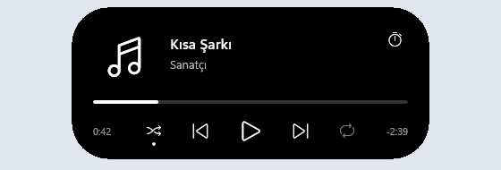
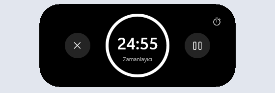

# Islora

Apple's Dynamic Island, brought to Windows 11. Islora shows what your PC is doing in a small black pill at the top of the screen, and hides when there is nothing to show.

<table>
  <tr>
    <td></td>
    <td></td>
  </tr>
  <tr>
    <td></td>
    <td></td>
  </tr>
</table>

> [!NOTE]
> v0.1 is an early release. The interface is in Turkish only, and Islora has only been run on a Windows 11 Insider build so far. Its design is moving closer to Apple's, so the timer and calendar screens will change.

## Download

Get `islora.exe` from the [latest release](https://github.com/ucanalgan/islora/releases/latest), put it in any folder and run it. There is no installer. It needs 64-bit Windows 11.

The file is not signed, so SmartScreen may warn you the first time. Choose **More info**, then **Run anyway**.

## What it shows

- **Music:** cover, title, artist, progress and playback buttons for any player that reports to Windows, such as Spotify or a browser. You can seek, shuffle and repeat when the player allows it.
- **Timers:** Islora's own countdown, Windows Focus sessions in both directions, and running timers from the Clock app. Clock timers are read-only, as Windows offers no public way to create them.
- **Calendar:** events from a private iCal address, as a bubble 30 minutes before they start, in the pill 5 minutes before, and as an alert when they begin.
- **System changes:** volume, brightness, Caps Lock, Num Lock, charger, low battery, Battery Saver, Bluetooth, sound output, microphone, camera, internet, Wi-Fi, VPN, airplane mode, USB drives, displays, screenshots, copied items, track changes and keyboard language.

Two things can run at once: the main one sits in the pill and the second in a bubble beside it, as on an iPhone.

The island hides during fullscreen apps and leaves itself out of screenshots, screen recordings and screen sharing.

## Using it

| To | Do this |
|---|---|
| Open the island | Press `Win+Alt+Space`, or move the pointer to the middle of the top screen edge. If that shortcut is taken, `Ctrl+Shift+Alt+Space` is used instead. |
| Expand or collapse it | Click the pill. Moving the pointer away also collapses it. |
| Switch to the second thing | Click the bubble. |
| Start a timer or see your next events | Open the home view with the timer icon or by pressing the shortcut twice. |
| Change settings | Right-click the tray icon. |

The tray menu has the demo, the settings file, start with Windows and the notch style.

## Settings

Settings live in `%APPDATA%\Islora\config.toml`, which is created on first run. After editing the file, choose **Takvimi ve ayarları yenile** in the tray menu.

| Setting | Meaning | Default |
|---|---|---|
| `calendar_ics_url` | Private iCal address of your calendar. Treat it like a password. | empty |
| `timer_presets` | The four durations in the home view, in minutes. | `5, 15, 25, 45` |
| `start_mode` | What those buttons start: `focus` for a Windows Focus session, `timer` for Islora's own countdown. | `focus` |
| `island_style` | `island` floats below the top edge, `notch` is attached to it. | `island` |
| `notices_off` | Notices to hide, separated by commas. The file lists the names. | empty |

## Privacy

Islora has no account and no telemetry. Its only network request downloads the calendar address you set, every 15 minutes. It never reads what you copy, only whether it was text, an image or a file, and it skips copies marked by password managers. From the Clock app's settings it reads the timers and nothing else.

## System load

Islora is written in Rust with no runtime or web view. Nothing polls: every source waits for a Windows event, and shape animations run in the Windows compositor, so the app itself does no work per frame. With nothing to show, v0.1 used 0 ms of CPU over 15 seconds and 7.4 MB of private memory. The exe is 3.2 MB.

The exception is the sound wave in the small pill while music plays. It loops, so the compositor (`dwm.exe`) redraws it on every frame, which costs about half a CPU core at 144 Hz. Start Islora with `--wave still` to stop it.

## Known limits

- App notifications are not shown yet.
- Only the primary display is used.
- The Windows volume flyout and notification banners still appear beside the island.
- Some notices are unit tested but have not been checked against real events yet. The [release notes](https://github.com/ucanalgan/islora/releases/latest) list them.

## Building

You need current stable Rust and the MSVC build tools with the Windows SDK.

```powershell
cargo build --release
cargo test -p island-core
```

The app is `target\release\islora.exe`. `crates/island-core` holds the logic and has no Windows dependency, so it can be tested on its own. `crates/island-app` holds the window, drawing and event sources. `spikes` keeps the early experiments and is not part of the build.

## Legal

Apple and Dynamic Island are trademarks of Apple Inc. Islora is an independent project and is not affiliated with or endorsed by Apple.

No license has been chosen yet, so all rights are reserved for now.
